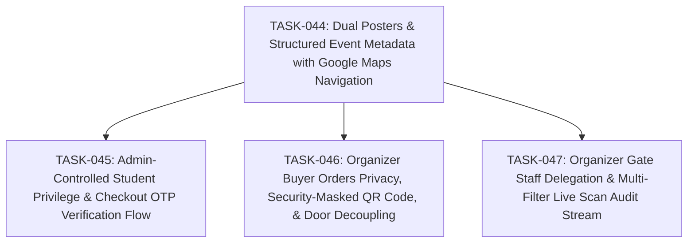

# SPEC-015: Task Map

- Spec: [SPEC-015-dual-posters-student-privilege-and-gate-delegation.md](../specs/SPEC-015-dual-posters-student-privilege-and-gate-delegation.md)

## Dependency Graph

## Task List

- [x] `TASK-044`: [Dual Posters & Structured Event Metadata with Google Maps Navigation](TASK-044-dual-posters-and-structured-event-metadata.md)
- [x] `TASK-045`: [Admin-Controlled Student Privilege & Checkout OTP Verification Flow](TASK-045-admin-student-privilege-and-checkout-otp.md)
- [x] `TASK-046`: [Organizer Buyer Orders Privacy, Security-Masked QR Code, & Door Decoupling](TASK-046-organizer-orders-masked-qr-and-buyer-details.md)
- [x] `TASK-047`: [Organizer Gate Staff Delegation & Multi-Filter Live Scan Audit Stream](TASK-047-gate-staff-delegation-and-scan-audit-filters.md)

## Acceptance Coverage

| AC | Task |
| --- | --- |
| AC-01 | TASK-044 |
| AC-02 | TASK-044 |
| AC-03 | TASK-045 |
| AC-04 | TASK-045 |
| AC-05 | TASK-044 |
| AC-06 | TASK-045 |
| AC-07 | TASK-045 |
| AC-08 | TASK-046 |
| AC-09 | TASK-046 |
| AC-10 | TASK-046 |
| AC-11 | TASK-047 |
| AC-12 | TASK-047 |
| AC-13 | TASK-047 |
| AC-14 | TASK-047 |
| AC-15 | TASK-047 |
| AC-16 | TASK-044, TASK-045, TASK-046, TASK-047 |
